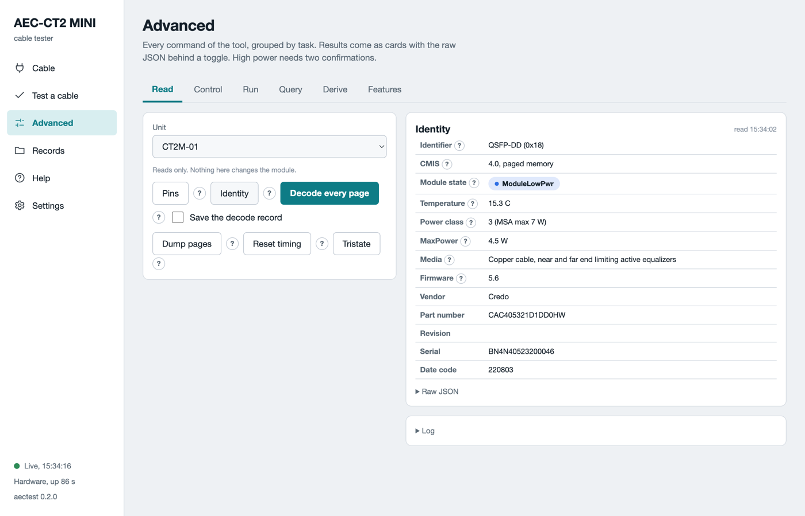

# Advanced

The **Advanced** page holds every command of the tool, grouped by task. Each result comes as a card with the raw data behind a toggle. Each button has a `?` with its meaning. High power needs two confirmations. This page is for engineers. A technician needs only [Test a cable](test-a-cable.md).

*The Read tab on a real cable. Identity shows the plate values as a table.*

## The tabs

The table lists the six tabs.

| Tab | What it holds |
|---|---|
| Read | Pins, Identity, Decode every page, Dump pages, Reset timing, Tristate. Nothing here changes the cable. |
| Control | Register read and write by page and offset. Release low power and hold for a time. |
| Run | PRBS both ways, Media link check, Trend, Loopback. Two units make a pair. |
| Query | Command block queries and the Firmware card. See [Firmware update](firmware-update.md). |
| Derive | The cable database. A criteria file from the plugged cable. |
| Features | Every advertised feature of the cable, and a way to exercise each one. |

## The cable passport

On the **Cable** page, **Read cable** reads the identity, the applications and the advertised pages. It also reads the diagnostic features, the thresholds and the firmware information. **Save passport** writes it as a JSON file and a printable HTML page into the record folder. A passport is the full description of one cable end at one time.

Some cables advertise a feature and return a placeholder. Examples: the same power on every lane, a signal to noise ratio of 0 dB, an all-zero monitor page. The passport lists these under hollow features. A chart never plots an all-zero series.

## Decode every page

**Decode every page** reads every page the cable advertises and shows each register with its name and meaning. The lane view comes first, then one block per page. Tick **Save the decode record** to keep it as a file. The same file renders the same way on the Records page.

## High power

A cable starts in low power, under 1.5 W. High power is its working state. The unit gives at most 6 W. The software refuses to release a cable that declares more.

To release a cable on the Control tab:

1. Pick the unit and the hold time in seconds.
2. Tick **I release LPMode on purpose**.
3. Tick **A 3 A charger is on PWR ONLY and the host on PC**. `PWR ONLY` is the **5V 3A** port.
4. Click **Release LPMode and hold**.

A budget above 6 W needs a reason in the **Reason for a budget change** box. The software writes the value and the reason into a record. The temperature watch of the guided test runs here too. Every end returns to low power when the job ends, with or without an error.

## PRBS between two ends

PRBS is a known bit pattern. The cable generates it on one end and checks it on the other. BER is errors divided by bits.

1. Open the Run tab. The page names the pair. The unit with the lower serial is end A.
2. Click **Swap A and B** to change which end sends first.
3. Pick the seconds per direction and the pattern. `prbs31q` is the default.
4. Pick the application when the cable has more than one.
5. Tick **Force on CMIS below 5.0** for a cable that reports CMIS 4.x.
6. Tick the two confirmations. Click **PRBS both ways**.

The live chart shows temperature and voltage. The result shows one card per direction with a lane table. Green is a BER below 1e-6. Amber is up to 2.4e-4, the ceiling a forward error correction still corrects. Red is above. Grey is a lane outside the mask.

**Media link check** brings the data path up on both ends and reports the linked lanes. **Trend** runs the pattern one way and samples every second. **Loopback through B** sends the pattern out of A and back through B. Both draw a strip under the chart with one cell per second. An amber cell marks a lane that lost lock in that second.

## Command block queries

The Query tab reads over the command block interface, CDB. **Query status** reads the engine state. **Firmware info** reads the banks and the versions. **Firmware features** and **Module features** list what the cable supports, with the command names grouped by family. Nothing here changes the cable.

## The cable database

The software keeps one criteria file per cable part number in its `criteria` folder. The Derive tab shows the path of each file it writes. A criteria file holds the limits a cable must meet. They cover the identity, the timing, the low-power and high-power ranges and the pattern test. The guided test picks the file whose vendor and part number rules accept the cable.

A cable without a file can get one from its own advertisement:

1. Open the Derive tab. Pick the unit with the cable.
2. Fill in your name and a note.
3. Tick the two confirmations when the ready time should be measured too.
4. Click **Derive from this cable**.

The result shows the file path and its first lines. Every derived limit is marked proposed and names its source register. Engineering reviews the file and confirms it. A test against a proposed file ends with the note **Criteria proposed, not confirmed**.

To add a file that engineering has confirmed, copy it into the `criteria` folder. Restart `aectest web`. The next **Read cable** matches it.

## The feature matrix

The Features tab lists every capability the cable advertises. Each row is in one of four states: works, hollow, not exercised, not advertised. **Build the matrix** reads the advertisement. **Exercise** on a row or a group runs the matching check and fills in the result. An exercise that needs high power carries the same two confirmations.

## What can go wrong

The table lists the refusals on this page.

| Symptom | What to do |
|---|---|
| `Refused: confirmations` | Tick both confirmation boxes before a high-power command. |
| `Budget refused` | The cable declares more than the budget. Raise it with a reason, or test a cable within the budget. |
| `CMIS 4.0 < 5.0` | Tick **Force on CMIS below 5.0** for a CMIS 4.x cable. |
| `not advertised` or `13h/14h` | The cable has no diagnostic pages. PRBS and loopback cannot run on it. |
| `One unit on the host` on the Run tab | A two-end run needs two units. Plug the second one and click **Refresh units**. |
| An all-zero SNR | The cable reports a placeholder. The chart says so. Not a defect of the unit. |
