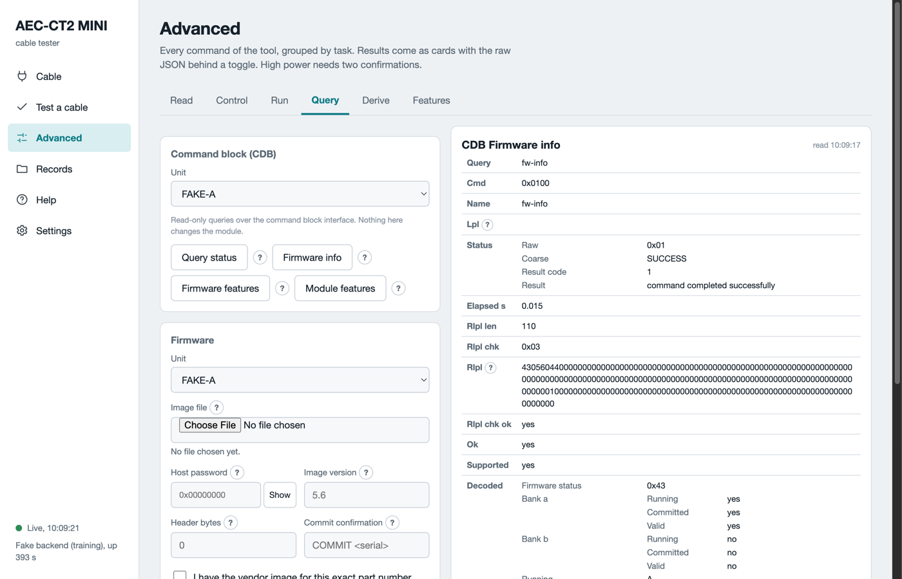

# Firmware update

A cable end has two firmware banks. One runs. The other can take a new image. The **Firmware** card sits on the Advanced page, Query tab. It downloads a vendor image into the free bank, runs it, and commits it when you say so. The cable stays in low power the whole time. A failed download leaves the running image untouched.



*The Firmware card in training mode. Firmware info shows both banks: which one runs, which one is committed, and their versions.*

## What you need

The table lists what you need before an update.

| Item | Why |
|---|---|
| The vendor image file for this exact part number | The software cannot check the file content. The vendor says which cable it is for. |
| The image version, as `X.Y` | The software compares it with the bank after the download. |
| The vendor host password, when the cable wants one | Without it the cable refuses every firmware command. |
| The header size in bytes, when the cable advertises one | Only when the cable asks for a vendor header. |
| The charger in **5V 3A** (`PWR ONLY` in the software), the cable seated | The download takes minutes. A lost contact aborts it. |

An active electrical cable has firmware in each end. The software updates the end in the unit. Swap the ends and run the update again for the other end.

## Update step by step

1. Open **Advanced**, then the **Query** tab. Pick the unit.
2. Click **Firmware info**. Read the banks and the versions. The download line says whether this cable accepts a download.
3. Choose the image file. The card shows its name, size and hash.
4. Type the host password when the cable needs one. The field never shows it again.
5. Type the image version. Type the header bytes when the cable advertises a header.
6. Tick **I have the vendor image for this exact part number**.
7. Tick **The charger is on PWR ONLY and the cable stays in until the end**. `PWR ONLY` is the **5V 3A** port.
8. Click **Plan**. The card lists every guard and every step. Nothing is written yet.
9. Click **Download**. A bar shows the blocks, the bytes, the elapsed time and the time left. Expect about three minutes per end.
10. Click **Firmware info** again. The free bank now holds the new version and reads valid.
11. Click **Run**. The cable resets and starts the new image. Wait for it to answer again.
12. Test the cable on the new image with [Test a cable](test-a-cable.md).
13. Type `COMMIT` and the cable serial into **Commit confirmation**, for example `COMMIT CRD0000000000001`. Click **Commit**.

A committed image boots at every reset. Until the commit, the next reset boots the old image. Commit only an image you have tested.

## The guards

The software refuses a step when a guard fails. There is no override except for the version guard. The table lists the guards.

| Guard | Rule |
|---|---|
| Advertised | The cable supports the command block and a write mechanism. |
| Quiet | The cable is in low power, or every lane is deactivated. |
| Size | The file is longer than the header and fits the image size field. |
| Header | The first header bytes carry the part number, or you typed the advertised header size. |
| Version | The file version is not the running version. **Force** allows a deliberate re-flash. |
| Commit | The confirmation string names this cable. A copy from another run fails. |
| Plan first | **Plan** prints the steps with no write. Read it before the first download. |

## On the command line

```sh
aectest bringup --serial CT2M-01 fw-info
aectest bringup --serial CT2M-01 fw-update --image FILE --image-version 5.6 --password 0x00001011 --plan
aectest bringup --serial CT2M-01 fw-update --image FILE --image-version 5.6 --password 0x00001011
aectest bringup --serial CT2M-01 fw-update --image FILE --image-version 5.6 --password 0x00001011 --run-only --run-image
aectest bringup --serial CT2M-01 fw-update --image FILE --image-version 5.6 --password 0x00001011 --run-only --commit --confirm 'COMMIT CRD0000000000001'
aectest bringup --serial CT2M-01 fw-abort
```

The password value above is an example. Use the one your vendor gives you. `--run-only` skips the download when a bank already holds the version. `fw-abort` ends a download the cable still holds open.

## What can go wrong

The table says what each failure leaves on the cable.

| Where it fails | What the software does | What the cable holds |
|---|---|---|
| Start refused | Aborts. Nothing was written. | The committed image runs. |
| A block write fails | Aborts the download. | The free bank is marked invalid. The committed image runs. |
| Complete fails | Aborts. The reason names the cable's rejection. | The same. |
| The new bank reads invalid | Aborts. | The same. |
| Run refused | Stops with `UPDATED, RUN REFUSED`. | The new image sits valid in its bank. The old one runs. |
| The cable stays silent after Run | Reports `RUN, MODULE SILENT`. | A power cycle boots the committed image. |
| Commit refused | Stops with `RUNNING, COMMIT REFUSED`. | The new image runs until the next reset. |
| Status `46h` on every command | The cable wants the host password. | Type the password and try again. |
| `The firmware update engine is not in this build` | The card is present but the engine is not installed. | Firmware info still works. Ask for a build with the engine. |

The download speed is set by the cable, about 1.4 s per 2048-byte block. The bus clock does not change it.
