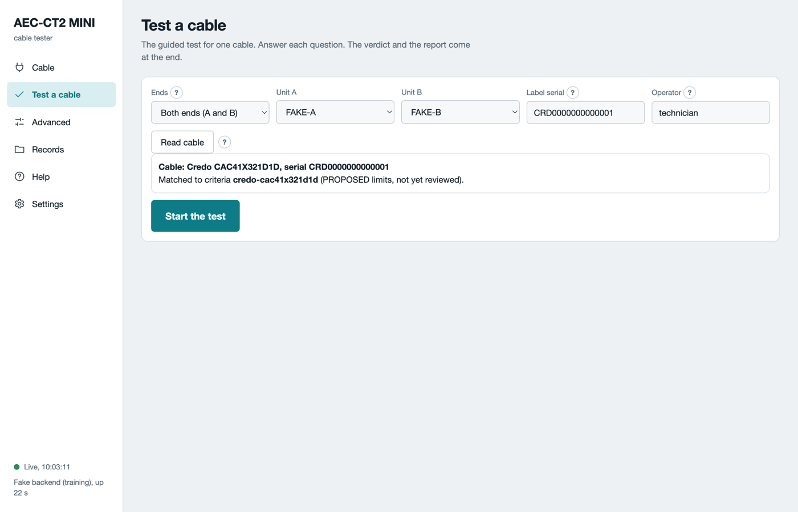
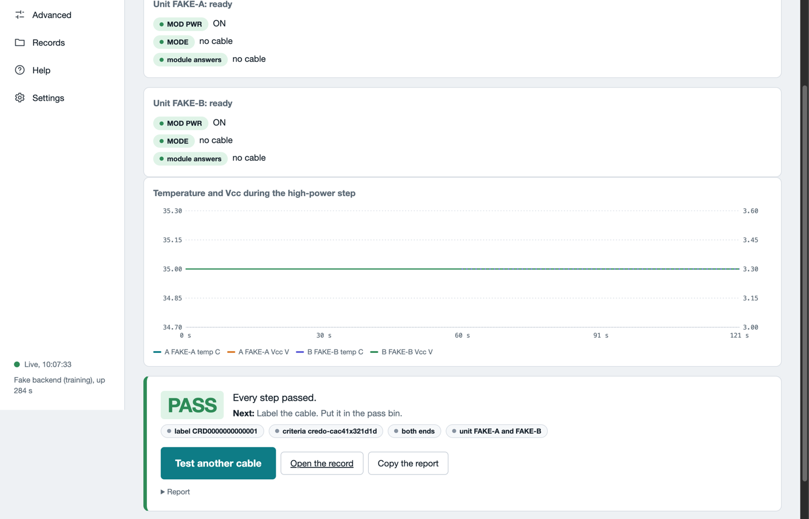

# Getting started

This page takes you from the box to the first cable verdict. It needs one or two tester units, a host computer and a cable. Follow the steps in order. The whole path takes about 30 minutes.

## What you need

The table lists what you need before the first test.

| Item | Why |
|---|---|
| One or two tester units | One unit reads one cable end. Two units test both ends at once. |
| One USB-C charger per unit, 5 V at 3 A | A cable in high power needs more current than a computer port gives. |
| One USB-C data cable per unit | The host computer talks to the unit through it. |
| A host computer with Python 3.11 or newer | Tested on Linux and macOS. Not tested on Windows. |
| A desk fan or a USB fan | A cable of power class 2 or higher needs air over the heat sink. You must feel the air at the fins. |
| The cable to test | Both ends of one cable for a full test. |

The lid of each unit carries its serial, `CT2M-NN`. The software shows the same serial. Unit A is the unit with the lower serial.

## Step 1: install Python

Open a terminal. Run `python3 --version`. A version of 3.11 or newer is enough. Skip to Step 2. Otherwise install Python for your system.

- **macOS**: install [Homebrew](https://brew.sh), then run `brew install python libusb`.
- **Linux** (Debian or Ubuntu): run `sudo apt install python3 python3-venv python3-pip`.
- **Windows**: install Python from [python.org](https://www.python.org/downloads/). Tick **Add python.exe to PATH**. The software is not tested on Windows. No USB driver steps are given for it.

## Step 2: get the software

Clone the repository, or download it as a zip from [GitHub](https://github.com/vppillai/aec-ct2-mini) and unpack it. Then run the commands in that folder.

```sh
git clone https://github.com/vppillai/aec-ct2-mini.git
cd aec-ct2-mini
python3 -m venv .venv
.venv/bin/pip install ./software
.venv/bin/aectest --version
```

The last line prints `aectest 0.2.0`.

On Linux, install the device rules now, before the first unit is plugged in:

```sh
.venv/bin/aectest setup-linux
```

The command asks for your password once. If a unit is already plugged in, unplug it and plug it in again.

## Step 3: place the units

1. Put each unit flat on the bench. Leave air space around the heat sink.
2. Take the hood off each unit. Put a finger in the scoop at the rear wall and lift. The closed box cannot cool a powered cable.
3. Leave the switches as shipped. **MODE** is at AUTO. The first slot, the power switch (`MOD PWR` in the software), is at ON. The three slides are at O.
4. Put the fan so that it blows across the heat sink of each unit. Run it for every test.

The [hardware page](hardware.md) names every switch and light.

## Step 4: power the units

The order matters. The charger goes in first.

1. Plug the charger into the **5V 3A** port (`PWR ONLY` in the software). The **5V IN** light comes on.
2. Plug the data cable into the **PC** port and into the host computer. The **USB** light comes on.

Do not pull the charger while a cable is in high power. See [Safety](safety.md).

## Step 5: start the software

```sh
.venv/bin/aectest web --open
```

The browser opens the page at `http://127.0.0.1:8765`. If no browser opens, type that address into one. The **Cable** page shows one card per unit it found. The **PC** light on each unit comes on when the software has opened it.

No unit yet? Try the simulation mode: `aectest web --dry-run --open`. It runs on two simulated units with a simulated cable.

## Step 6: read the cable

1. Insert one cable end into each unit. Push until the latch clicks.
2. On the **Cable** page, click **Read all cables**.
3. Read the plate: the vendor, the part number, the power class and the test features.

The plate says whether the cable fits the power budget of the unit. The budget is 6 W.

## Step 7: test the cable

1. Open **Test a cable**.
2. Choose **Both ends** when a cable end sits in each unit. Choose **One end** with one unit.
3. Click **Read cable**. The label serial fills in. The page names the criteria file that matches the cable.
4. Scan or type the label serial when it differs from the one on the plate.
5. Click **Start the test**. Keep your hands off the units until the end.



*The setup form after Read cable, in simulation mode. The simulated cable matched a proposed criteria file, so Start the test is enabled.*

The test runs eight steps. The page says what each step reads and judges. A full test takes about five minutes. [Test a cable](test-a-cable.md) gives the time of each step.

## Step 8: read the verdict

At the end the page asks you to remove the cable. Pull both ends by their pull tabs. Click **Done**. The page then ends with one card.

- **PASS**, green. Every step passed. Label the cable and put it in the pass bin.
- **FAIL**, red. The cable produced the evidence. Put it in the fail bin with the reason code.
- **INCONCLUSIVE**, amber. The test could not finish. The card names the fix. Run the test again.



*The end of a test in simulation mode. The card names the next step. Copy the report for a ticket.*

Click **Test another cable** for the next one. Every run leaves a folder of records. See [Records](records.md).

## What can go wrong

The table lists the first things that go wrong on a new bench.

| What you see | What to do |
|---|---|
| The **USB** light stays dark | The data cable is in the wrong port. Move it to **PC**. |
| The page lists no unit | Check the **PC** cable. On Linux, run `aectest setup-linux` and plug the unit again. Click **Refresh units**. |
| The **POWER** light flickers | The charger is too weak. Use a 5 V, 3 A charger on **5V 3A**. |
| Read cable says NACK | The cable did not answer. Set **MODE** to AUTO on the unit, then click **Read cable** again. |
| No criteria for this cable type | Click **Test without criteria**, or ask engineering for a criteria file. |
| The verdict is INCONCLUSIVE THERMAL | The cable got too hot. Let it cool, put air over the heat sink, then run again. |

More cases are on the [troubleshooting page](troubleshooting.md). To report a problem, see [Report a problem](troubleshooting.md#report-a-problem).
