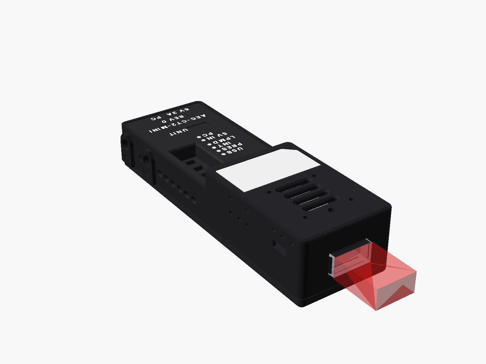
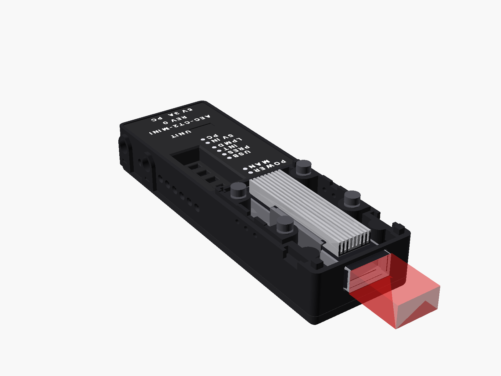
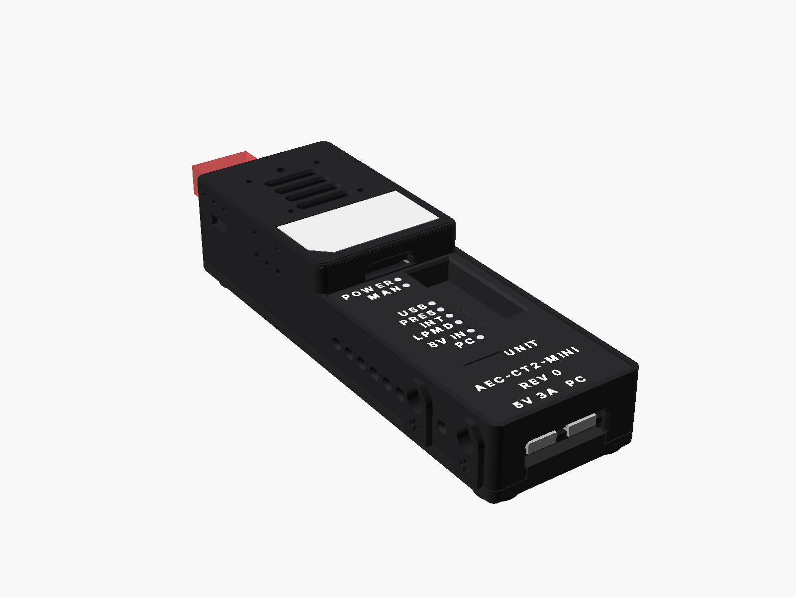
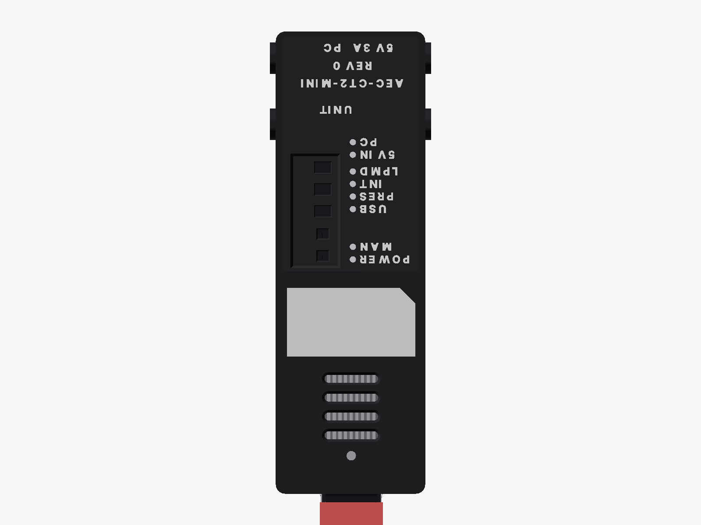
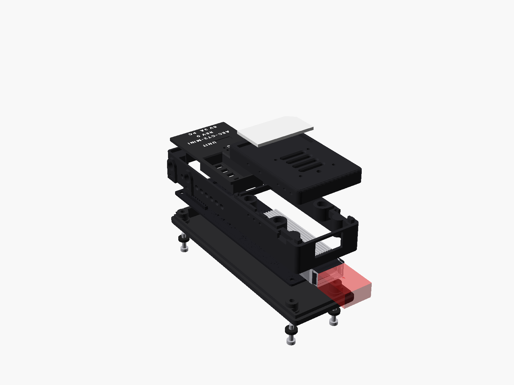

# Hardware

The tester is a small black box. It has one cable port at the front and two USB-C ports at the rear. One circuit board sits inside. The box has four printed parts. They are a tray, a body, a lid with the legends, and a hood over the cable port.

*The unit from the front. The red block shows where a cable plug sits.*

## What is in the box

The box holds one unit with its hood on.

| Part | What it does |
|---|---|
| The unit | One tester with its hood. The serial `CT2M-NN` is written in the **UNIT** field on the lid. |

The charger, the data cable and the fan are on the [Getting started](getting-started.md) list. Check them before the first test.

## The names on the lid

The lid carries the words the user sees. The software uses some other words. This table gives both.

| Function | Word on the lid | Word in the software | Light or switch position |
|---|---|---|---|
| The charger port | **5V 3A** | `PWR ONLY` | Rear, left. |
| The host port | **PC** | `PC` | Rear, right. |
| The cable power switch | No word. The first slot in the well. | `MOD PWR` | The bar marks ON. Shipped at ON. |
| The mode switch | **MODE** | `MODE` | The bar marks MAN. Shipped at AUTO. |
| The select slide | **MSEL** | `MSEL` | The bar marks H. Shipped at O. |
| The reset slide | **RESET** | not named | The bar marks H. Shipped at O. |
| The low-power slide | **LPMD** | `LPMode` | The bar marks H. Shipped at O. |
| The cable rail light | **POWER** | not named | Green. |
| The manual mode light | **MAN** | not named | Yellow. |
| The host 5 V light | **USB** | not named | Blue. |
| The cable present light | **PRES** | not named | Green. |
| The interrupt light | **INT** | not named | Yellow. |
| The low-power light | **LPMD** | not named | Blue. |
| The charger light | **5V IN** | not named | Green. |
| The software open light | **PC** | not named | Green. |

Every page uses the lid word. The software word follows in brackets the first time a page uses it.
Early lids print **PRBS** and **INIT** for the cable present light and the interrupt light. The meaning is the same.

## Each face of the unit

### Front: the cable port

The front face has one QSFP-DD port. Push the cable plug in until the latch clicks. Pull the plug out by its pull tab. Never pull on the cable itself.

### Top, front: the hood

The hood covers the cable port and the heat sink. It has four vent slots and a grey name plate. The four small holes take an optional 30 mm fan. No fan is fitted in this release. So the hood comes off for every powered test.

Magnets hold the hood. To lift it, put a finger in the scoop at the rear wall of the hood. The hood fits one way. A turned hood does not seat.

*Hood off: the heat sink stands open for air. Take the hood off for every powered test.*

### Top, rear: the lid

The lid carries the controls and the legends. From the front to the rear you see:

- the switch well with five slide switches,
- the LED column with eight lights,
- the **UNIT** field with the serial of the unit,
- the product name and the board revision,
- the port names **5V 3A** and **PC** above the rear edge.

*The rear view. The legends read upright when the cable port points away from you.*

### Rear: the two USB-C ports

Hold the unit with the cable port pointing away from you. The legends now read upright. The table lists the two ports from left to right.

| Position | Name on the lid | Use |
|---|---|---|
| Left | **5V 3A** | The charger port. It takes a 5 V, 3 A USB-C charger. It carries no data. The software calls it `PWR ONLY`. |
| Right | **PC** | The host port. It connects to your computer. It carries data and 5 V. |

When a charger is plugged in, the charger feeds the unit. The host port then carries data only. Plug the charger in first and the host cable second. See [Safety](safety.md).

### Sides and sole

Each long side has a row of vent slots. Two round bosses sit on each long side near the rear. They belong to a coupling feature under test. The sole has four rubber feet. The feet cover the four screws that hold the box together. The sole carries no label.

*The top view, cable port at the bottom. The legends read upside down from this side.*

## The switches

The five slide switches sit in the well on the lid. Move a switch with a fingernail or a pen tip of 2.5 mm or less. A label on the well floor names four switches. The first slot, nearest the front, has no word. A white bar beside each slot marks one end of that slot.

| Switch | Positions | What each position does | As shipped |
|---|---|---|---|
| The first slot (`MOD PWR`) | ON, OFF | ON feeds 3.3 V to the cable port. OFF cuts it. The bar marks ON. | ON |
| **MODE** | AUTO, MAN | AUTO lets the software drive the three control lines. MAN gives the lines to the three slides below. The bar marks MAN. | AUTO |
| **MSEL** | H, O, L | The select line of the cable. H deselects it. L selects it. O leaves the line to the software. The bar marks H. | O |
| **RESET** | H, O, L | The reset line. H lets the cable run. L holds it in reset. O leaves the line to the software. The bar marks H. | O |
| **LPMD** | H, O, L | The power line. H holds the cable in low power. L allows high power. O leaves the line to the software. The bar marks H. | O |

Leave every switch as shipped for a test with the software. The software drives the control lines. It names a switch only when the switch is wrong.

Without a host cable in **PC**, the unit works as if **MODE** were at MAN. The three slides then own the control lines. This is the stand-alone mode. In stand-alone mode keep **LPMD** at H. A cable in high power needs the software to watch its temperature.

## The LEDs

The eight lights sit in one column on the lid. Look at the two rear lights, **5V IN** and **PC**, from straight above. They are dark from an angle. The table lists the lights from the front to the rear.

| Light | Colour | Lit means | What to check |
|---|---|---|---|
| **POWER** | green | The 3.3 V cable rail is on. | A flicker means a weak supply. Stop. Use a 3 A charger on **5V 3A**. |
| **MAN** | yellow | The slides own the control lines. | Lit with **USB** dark: no host cable, stand-alone mode. |
| **USB** | blue | 5 V is present on the **PC** port. | Dark with the host cable in: the cable is in the wrong port. |
| **PRES** | green | A cable end is in the port. | It can glow with no cable while the power switch is OFF. Ignore it then. |
| **INT** | yellow | The cable raised an interrupt. | Lit right after you insert a cable is normal. The software clears it. |
| **LPMD** | blue | The cable end is in low power. | Dark means high power. Do not pull the cable or the charger now. |
| **5V IN** | green | A charger is on the **5V 3A** port. | Dark before a high-power test: plug the charger in. |
| **PC** | green | The software has opened the unit. | Dark with **USB** lit: a driver or permission problem on the computer, or the port did not register the unit. Plug it again, or use another port. |

The cable's own light is not visible through the box.

## The unit label

Each unit has a serial in the form `CT2M-NN`. The serial is written in the **UNIT** field on the lid. The same serial sits in the memory of the unit. The software reads it from there.

To read the record in the software, open the **Cable** page. The card of each unit shows the serial as its title. Below it, a line reads the board revision and the batch. Open the details to see every field. The table lists them.

| Field | Meaning |
|---|---|
| Unit serial | The serial `CT2M-NN`, the same as on the lid. |
| Board revision | The revision of the circuit board. |
| Batch | The batch the board came from. |
| Case | The case set the unit sits in. |
| Build date | The date the record was written. |

Quote the unit serial when you ask for help. On the command line, `aectest bringup --list` prints the serial of every connected unit.

## One unit and the pair

One unit holds one cable end. With one unit you read the identity, the monitors and the alarms of that end. You can also power it up and watch its temperature.

Two units hold both ends of one cable. The software then runs the pattern test from end A to end B and back. This is the full cable test. Unit A is the unit with the lower serial.

Place the two units side by side. They need no mechanical link. The software pairs them by serial.

## Inside the box

The box holds one circuit board. The cable port, its heat sink, the switches, the lights and the two USB-C ports sit on the top side. The electronics sit on the bottom side. You never need to open the box.

*The parts of the box, from the bottom: feet and screws, tray, board, body, lid, hood and name plate.*

## Care and cleaning

- Wipe the box with a dry or slightly damp lint-free cloth. Keep liquids out of the cable port, the light holes and the USB-C ports.
- Put nothing but a QSFP-DD plug into the cable port.
- Keep the hood on when the unit is not in use. The port has no dust cover.
- The box is printed in PLA. It softens at about 55 °C. Keep it out of the sun and out of a parked car.
- The cable port is rated for 100 insertions. A cable plug is rated for 50. Count your insertions.
- Do not open the box. The four screws under the feet hold the board. Nothing inside needs service.
- Store a spare unit in an anti-static bag with the hood on.
