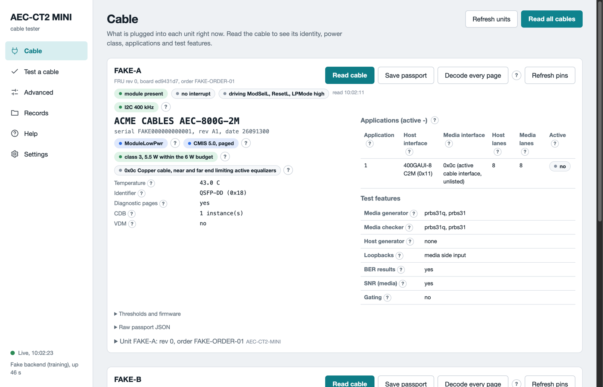

# Introduction

A QSFP-DD active electrical cable has a small computer in each plug. It reports who made the cable, how much power it needs and how warm it is. It also reports whether its lanes carry data without errors. A switch port reads this data. A bench without a switch cannot. The AEC-CT2-MINI is that reader in a hand-held unit.

## What the tester is

The unit has one QSFP-DD port, one USB-C port for the host computer and one USB-C port for a charger. The host computer runs the software. The software powers the cable end, reads its data over the management bus and writes a record. Two units beside each other hold both ends of one cable. Then the software sends a test pattern from one end and counts the errors at the other end.

The tester has no data lanes of its own. It cannot carry network traffic. It tests the cable with the cable's own test features.

## What you get from it

The table lists what the tester gives you.

| You want | The tester gives you |
|---|---|
| A verdict for an incoming cable | PASS, FAIL or INCONCLUSIVE with a reason code and a report |
| The identity of a cable | Vendor, part number, serial, revision, date code, power class |
| A look at the cable's health | Temperature, supply voltage, state and alarm flags, live |
| A link test between the two ends | Bit error ratio per lane in both directions |
| A new firmware on the cable | A guided update with a plan, a download, a run and a commit |

## One-minute tour

The software opens in your browser. The left side has six pages.

1. **Cable**: what is plugged into each unit now. Read the cable to see its plate.
2. **Test a cable**: the guided test. Read the cable, start the test, read the verdict.
3. **Advanced**: every command, grouped by task. For engineers.
4. **Records**: every file the tester wrote, grouped by cable. Click one to plot it.
5. **Help**: how to use each page, the glossary and a troubleshooting table.
6. **Settings**: the theme, the clock ramp rounds and the record folders.

*The Cable page in training mode. One card per unit. The plate shows the identity, the applications and the test features.*

## Where to go next

- [Getting started](getting-started.md) takes you from the box to the first verdict.
- [Test a cable](test-a-cable.md) explains each step and each verdict.
- [Safety](safety.md) lists the rules that protect you and the cable. Read it before the first high-power test.
