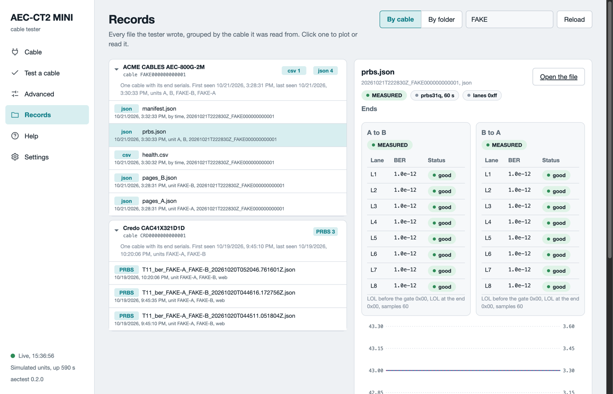

# Records

Every run writes files. The web UI and the command line write the same files to the same place. The **Records** page lists them by cable and plots the one you click. You never edit a record. A report for a ticket is a copy, not the record.

*The Records page in simulation mode. The left side groups files by cable. The right side shows the lane table and the chart of the chosen file.*

## Where the files go

The software writes under `out/test` in the folder where you started it. The Settings page lists the record folders. Each guided test gets one session folder named by its start time and the cable serial, for example `out/test/20261021T170314Z_CRD0000000000001`.

| File | Content |
|---|---|
| `manifest.json` | The run: units, cable, criteria file, operator, verdict, key numbers, one hash per file. |
| `events.jsonl` | Every step, sample, answer, refusal and verdict in order. Append-only. |
| `pages_A.json`, `pages_B.json` | The cable pages of each end, raw and decoded. |
| `prbs.json` | The pattern test: BER and errors per lane per direction, with the read-backs. |
| `health.csv` | Temperature, voltage, state and flags of each end, once per second. |
| `report.md` | The one-page report: verdict, reason codes with meanings, next step, key numbers. |

The manifest carries the hash of every file. An engineer can replay a session from the files alone.

## Other records

The table lists the records outside a session folder.

| Record | Where it comes from |
|---|---|
| `passport_<unit>_<serial>_<time>.json` and `.html` | **Save passport** on the Cable page. |
| A decode record | **Decode every page** with **Save the decode record** ticked. |
| A PRBS, trend or loopback record | The Run tab on the Advanced page. |
| A dump | **Dump pages** on the Read tab. |
| `out/test/units/<serial>.json` | The insertion count of each unit. The only file the software updates in place. |
| `out/test/lot_<id>/` | A lot run from the command line: one session folder per cable, plus `lot.csv` and `lot.md`. |

## The Records page

1. Open **Records**. Runs group by cable, with the serial on the card.
2. Type in the filter to find a cable, a unit or a file name.
3. Click a record. A pattern test shows its lane tables and charts. A dump shows its decoded fields. A report shows its text.
4. Click **By folder** to see the files by session folder instead.

A copper cable has two end serials and one card. An optical module is one module with its own serial, so a two-end record appears under both modules.

## Share a result

- For a ticket: click **Copy the report** on the verdict card. Paste it.
- For engineering: zip the session folder. Every file they need is inside, with its hash in the manifest.
- For a whole lot from the command line: `aectest inspect export --lot ID` writes one zip of the lot.

Nothing is uploaded anywhere. Everything stays on the host computer.

## What can go wrong

The table lists what can look wrong on the Records page.

| Symptom | What to do |
|---|---|
| The Records page is empty | No run has written a file yet. Run a test or save a passport. Click **Reload**. |
| A file sits under `No cable identity` | The file names no cable, for example a note. It is still in the folder. |
| A record from a simulation run | Its manifest carries `dry_run: true`. It is never a real result. |
| A session with no verdict | The run was stopped or the server went away. The events file holds the last state. |
