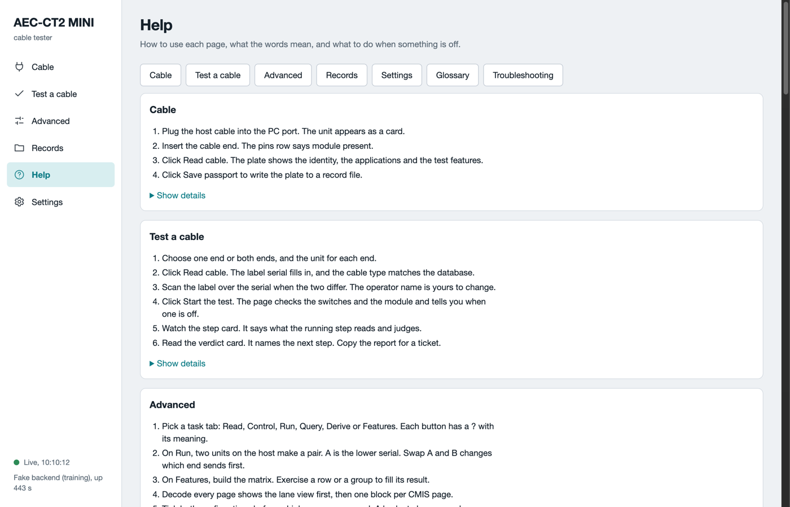
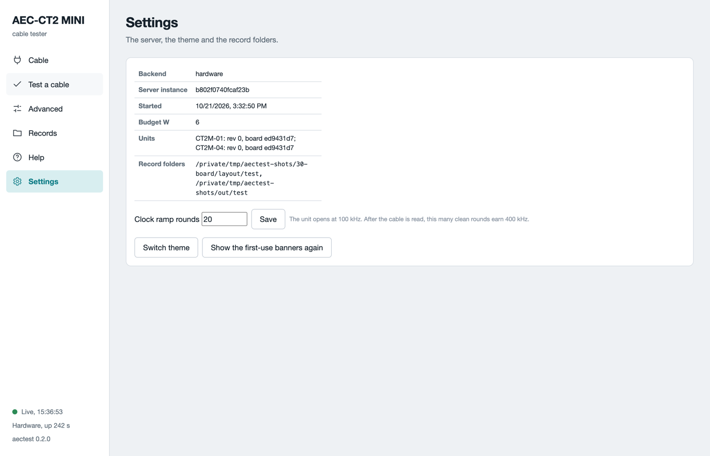

# Software

The software is one Python package, `aectest`. It runs on the host computer. It serves a web page in your browser and offers the same functions on the command line. Both write the same record files.

## Install

The table lists what the software needs.

| Need | Value |
|---|---|
| Python | 3.11 or newer |
| Operating system | Tested on Linux and macOS. Not tested on Windows. |
| USB | One free USB port per unit |
| Dependencies | Installed by pip: `pyftdi`, `pyyaml`, `rich` |

[Getting started](getting-started.md) has the install steps. They are Python per system, the clone, the venv, `pip install ./software`, and the Linux device rules. The rules must be in place before the first unit is plugged in.

### Versions that work together

Software 0.2.0 runs with board revision 0 in case v4. `aectest --version` prints the software version. The Cable page shows the board revision of each unit.

### Update the software

In the repository folder, run:

```sh
git pull
.venv/bin/pip install ./software
.venv/bin/aectest --version
```

With a zip download, unpack the new zip and run the last two commands in the new folder. Compare the printed version with the [release notes](release-notes.md). Restart `aectest web` after an update.

The software opens the unit with a fixed version of `pyftdi`. It refuses to start on another version and says so.

## Start the web UI

```sh
.venv/bin/aectest web --open
```

The page runs at `http://127.0.0.1:8765` on your computer only. If no browser opens, type that address into one. `--port N` changes the port. `--dry-run` starts the training mode with two simulated units. The software finds the units at start and every 10 seconds while idle. **Refresh units** on the Cable page looks again.

The server owns the units it opened. Stop it before a command-line run on the same unit. A second program that tries the same unit is refused.

## The pages

The table lists the six pages of the web UI.

| Page | What it does |
|---|---|
| Cable | One card per unit. **Read cable** shows the plate. **Save passport** writes it to a file. **Decode every page** lists every register with its meaning. |
| Test a cable | The guided test. See [Test a cable](test-a-cable.md). |
| Advanced | Every command by task: Read, Control, Run, Query, Derive, Features. See [Advanced](advanced.md). |
| Records | Every file the tester wrote, grouped by cable. Click one to plot or read it. See [Records](records.md). |
| Help | A how-to per page, the glossary and a troubleshooting table. |
| Settings | Light or dark theme, the clock ramp rounds, the record folders, the first-use banners. |



*The Help page in training mode. Each card has the steps for one page and the details behind Show details.*



*The Settings page in training mode. The record folders are where the files go.*

Every field with a `?` has a one-line meaning. The glossary on the Help page lists them all.

## The connection

The page keeps a heartbeat to the server. The corner says **Live** with the time of the last beat. When the server stops, a banner says so and the page reconnects on its own. After a restart the page reloads and keeps your form values.

## The command line

The command line serves the same functions. Use it for scripts, for a lot of cables, or on a computer without a browser. The table lists the main commands.

| Command | What it does |
|---|---|
| `aectest --version` | Print the version. |
| `aectest web --open` | Start the web UI and open the browser. |
| `aectest bringup --list` | List the units on this computer. |
| `aectest bringup --serial CT2M-01 id` | Read the identity of the cable in one unit. |
| `aectest tech run --jig PROFILE --sku auto` | Run the guided test. The cable picks its criteria file. |
| `aectest tech last` | Print the newest report. |
| `aectest inspect start --lot ID --sku NAME --jig PROFILE --operator NAME` | Test a lot: scan, test, scan, until `done`. `--sku` is a criteria file name, for example `credo-cac41x321d1d`. |
| `aectest inspect export --lot ID` | One zip of the whole lot for engineering. |
| `aectest selftest` | Run the built-in checks on simulated units. |

`aectest-tech` is the same program with the technician commands only. Every command has `--help`. The full command reference, every verb and flag, is in `software/README.md` in the repository.

The guided test on the command line needs a jig profile. The profile names the two units and records that the power setup was checked. An engineer writes and signs it once per bench. Copy the example file in the package, `jig_profile.example.yaml`. Then sign it:

```sh
.venv/bin/python -m aectest.jig sign PROFILE.yaml "Your name"
```

A profile edited after signing is refused. Sign it again.

## Training mode

Every command takes `--dry-run`. The software then talks to two simulated units with a simulated cable. Use it to learn the pages before the first real cable. The records of a dry run are marked as such and never count as real results.

## What can go wrong

The table lists the software problems and their fixes.

| Symptom | Cause | What to do |
|---|---|---|
| `no FTDI device found` | The USB chip of the unit is not on the bus, or the rules are missing. | Check the **PC** cable. On Linux, run `aectest setup-linux`. |
| The start refuses with a `pyftdi` version line | Another version is installed. | Reinstall with `pip install ./software`. |
| `No unit on the host` in the browser | Another program holds the unit. | Close the other program. Click **Refresh units**. |
| The page says `Server not reachable` | The server stopped. | Start it again. The page reconnects on its own. |
| A unit disappears during a run | The USB link dropped. | Unplug the host cable and the charger. Wait 30 s. Plug the host cable, then **Refresh units**. |
