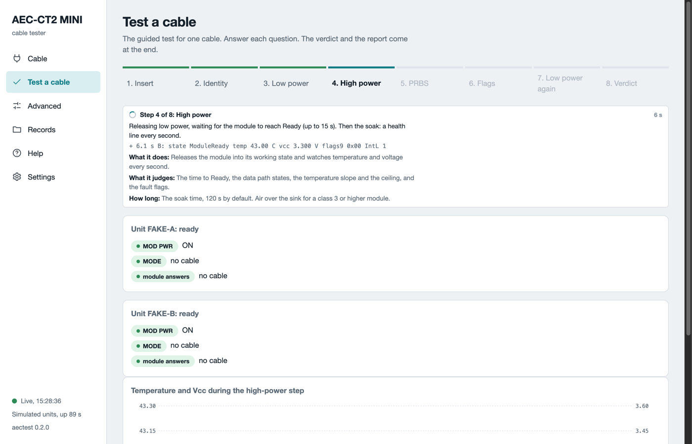

# Test a cable

The **Test a cable** page runs one cable through eight steps and ends with one word: PASS, FAIL or INCONCLUSIVE. You read the cable, start the test and answer a question when the page asks one. The page writes a report and a folder of records for every run.

## Before you start

- The hood is off each unit. A powered test with the hood on is not allowed.
- On every unit, the charger is in **5V 3A** (`PWR ONLY` in the software). The host cable is in **PC**.
- The switches are as shipped. **MODE** is at AUTO. The power switch (`MOD PWR`) is at ON. The slides are at O.
- The fan blows across the heat sink. A class 2 or higher cable needs it.
- Each cable end sits in a unit with the latch clicked. Unit A is the unit with the lower serial.

## Run the test

1. Open **Test a cable**.
2. Choose the ends. **Both ends** tests the whole cable on two units. **One end** reads one end on unit A.
3. Click **Read cable**. The label serial fills in from the cable. The page names the criteria file that matches.
4. Scan the label into the **Label serial** box when it differs. A typed value wins over the read.
5. Check the **Operator** box. It holds your login name. Change it when you want.
6. Click **Start the test**.
7. The page checks the switches and the module on each unit. A miss shows one fix and a **Retry** button.
8. Watch the step card. It says what the running step reads, what it judges and how long it takes.
9. At the end the page asks you to remove the cable. Click **Done**.
10. Read the verdict card. It names the next step.

*Step 4 of 8 in simulation mode. The step card, the pre-check of both units and the top of the live chart.*

**Back to setup** stops a run before the first step and keeps the form. **Stop the test** ends the run at any step. A stopped run stays on record.

## The eight steps

The table lists the eight steps, what each one does and what it judges.

| Step | What it does | What it judges |
|---|---|---|
| 1. Insert | Waits for the cable end to seat, or finds it seated already. | The time to the first answer on the management bus. |
| 2. Identity | Reads the vendor, part number, serial, date code, CMIS version and power class. | The part number against the criteria. The label serial against the cable serial. |
| 3. Low power | Reads the state, temperature, voltage and flags while the cable draws under 1.5 W. Saves its pages. | The state is low power. The voltage is in range. No fault flag is set. |
| 4. High power | Releases the cable into its working state. Watches temperature and voltage every second for the soak time. | The time to ready, the data path states, the temperature slope and ceiling, the fault flags. |
| 5. PRBS | Sends a test pattern from one end and counts errors at the other. Then the other direction. Both ends only. | The bit error ratio per lane against the limit. |
| 6. Flags | Reads the latched alarm and warning flags and the extra monitors. | No alarm set. |
| 7. Low power again | Puts the cable back into low power and leaves every control pin safe. | The cable returns to low power. |
| 8. Verdict | Judges every value against the criteria file. Writes the report. | PASS, FAIL or INCONCLUSIVE with one reason code per miss. |

The soak is 120 s by default. Each pattern direction runs 60 s. A full test takes about five minutes. With **One end** the PRBS step does not run and the report says so.

Every step is a button after the run. Click one to see its result cards.

## The temperature watch

During the high-power step the software reads the cable's own temperature every second. At the cable's warning level it prints one yellow **WARN** line and continues. At the throttle point it pulls the cable back to low power and stops. The throttle point is 5 °C below the cable's alarm level, or 70 °C. The verdict is then INCONCLUSIVE with the code THERMAL. The cable is not judged. Let it cool, improve the air over the heat sink and run again.

## The verdict

| Word | Meaning | What you do |
|---|---|---|
| **PASS** | Every criterion was met. Both directions were measured. | Label the cable. Put it in the pass bin. |
| **FAIL** | The cable itself produced the evidence. Only a cable can fail. | Put the cable in the fail bin with the reason code. Do not run it again to make it pass. |
| **INCONCLUSIVE** | The unit, the bench, the temperature or the software could not finish. The cable is not judged. | Do the fix on the card. Run the test again. |

A cable that matched a criteria file marked as proposed gets the note **Criteria proposed, not confirmed**. Hand the record to engineering. Do not bin the cable.

## Reason codes: INCONCLUSIVE

| Code | Plain meaning | What you do |
|---|---|---|
| `JIG-UNIT-MISSING` | The software found only one of the two units. | Check both **PC** cables and both **USB** lights. Click **Refresh units**. |
| `NO-CRITERIA` | No criteria file matches this cable. | Test without criteria, or ask engineering for a file. |
| `POWER-UNACKED` | The jig profile is missing, unsigned or edited. Command line only. | Ask the engineer who set up the bench. Do not edit the profile. |
| `NOT-PRESENT-A` or `-B` | That unit senses no cable end. | Seat that end until the latch clicks. Run again. |
| `NO-ACK-A` or `-B` | That end does not answer on the management bus. | Swap the ends and run again once. |
| `OVER-JIG-BUDGET` | The cable declares more power than the unit can give. | This cable cannot be tested on this unit. Hand it to engineering. |
| `PRBS-NOT-ADVERTISED` | The cable has no built-in pattern test. Not a defect. | Engineering decides for this cable type. |
| `PRBS-INCONCLUSIVE` | The pattern test ran but its result is not trustworthy. | Seat both ends again. Run again once. |
| `DP-NOT-ACTIVATED` | The data path did not come up on every lane. | Seat both ends again. Run again once. |
| `THERMAL` | The cable got too hot. The software stopped the test. | Let it cool. Put air over the heat sink. Run again. |
| `REMOVED-MID-TEST` | A cable end lost contact during the test. | Seat it again. Run again. |
| `ABORTED` | The run stopped for the reason in the text. | Read the text. Fix what it names. Run again. |

## Reason codes: FAIL

| Code | Plain meaning |
|---|---|
| `ID-VENDOR`, `ID-PN` | The vendor or part number in the cable is not the one in the criteria file. Check the file once. |
| `ID-SN-LABEL` | The scanned label differs from the serial inside the cable. Scan once more. |
| `ID-ENDS-DIFFER` | The two ends report different part numbers. Check that both ends belong to one cable. |
| `STATE-LOWPWR`, `STATE-READY` | The cable did not reach low power after insertion, or ready after release. |
| `MGMT-INIT-SLOW` | The cable took more than 2 s to answer after insertion. |
| `TEMP-OVER-LIMIT` | The cable ran over its temperature limit. |
| `VCC-OUT-OF-RANGE` | The cable reports its supply voltage out of range. Several in a row: suspect the unit. |
| `FLAGS-BYTE9`, `TX-FAILURE-FLAG` | The cable raised its own alarm or transmitter failure flag. |
| `BER-LANE-n`, `ERRORS-LANE-n` | Lane n had too many bit errors. |
| `NO-ACK-END` | The same cable end answered on neither unit after a swap. |

## The swap rule

1. After `NOT-PRESENT`, `REMOVED-MID-TEST`, `DP-NOT-ACTIVATED` or `PRBS-INCONCLUSIVE`: seat both ends again and run once more.
2. After `NO-ACK-A` or `NO-ACK-B`: swap the ends between the units and run once more.
3. The problem follows the cable end: the verdict becomes FAIL `NO-ACK-END`.
4. The problem stays with the unit: stop using that unit and tell engineering.
5. Never run one cable more than twice for the same INCONCLUSIVE code. Each run uses one of the cable's 50 rated insertions.

## What can go wrong

| Symptom | What to do |
|---|---|
| **Start the test** stays grey | Click **Read cable** first. The page needs the identity to pick the criteria. |
| The pre-check names a switch | Set the switch as the card says. Click **Retry**. |
| `NACK from slave` on read | The cable did not answer. **MODE** is at MAN and the **MSEL** slide deselects the cable. Set **MODE** to AUTO. Read again. |
| The run ends with `Connection lost` | The server stopped. Wait for **Live** in the corner. Start the test again. |
| The label serial box is empty | Type or scan the label. An empty box is recorded as not scanned, never as a failure. |
